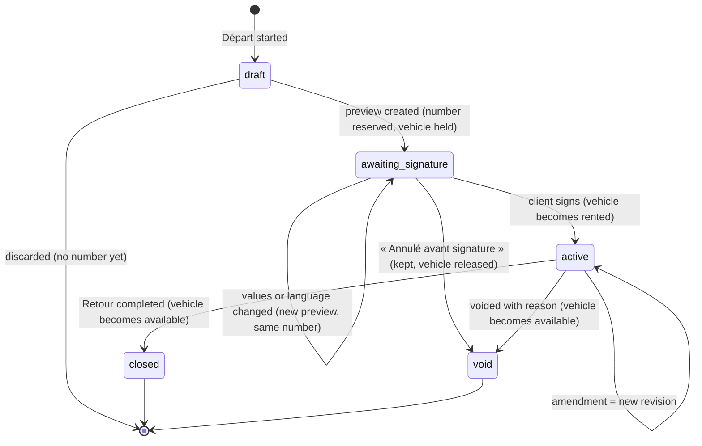
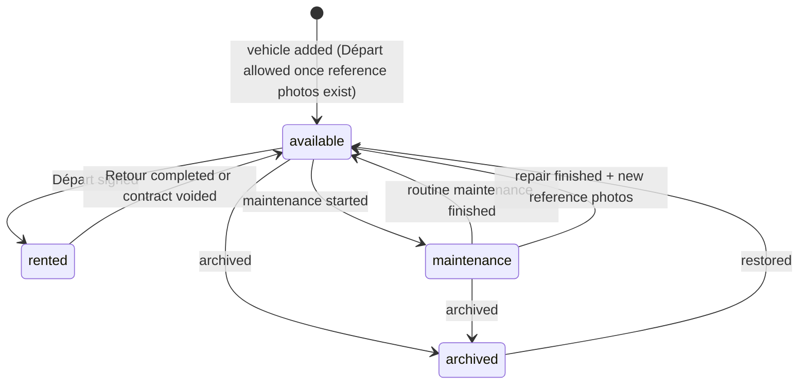

# ADR-0007: Contract and vehicle lifecycle: signed data is immutable, changes create revisions, everything is audited

| Status | Date | Decided by | Based on |
|---|---|---|---|
| **Accepted** | 2026-10-07 (updated 2026-11-10) | Developer, with the client's answers | Brief · B-06, B-08 · F-04, F-18, F-22, F-26, F-28 (answered) · defaults for R-09, R-11, R-12, R-13 |

## Context

- The brief prefers a history and audit trail to overwriting signed data.
- Staff must be able to extend or modify an active rental.
- Return information is added later, at the Retour.
- Both phones work on the same data at the same time.

## Decision

- **Contract:** a header (number, vehicle, renter, status) plus numbered **revisions**.
  - Revision 1 is the Départ as signed.
  - Each amendment, for example an extension, is a new revision with a full snapshot of the contract terms, a reason, its author and the time. It is recorded in the app only: there are no amendment pages in the PDF (F-22), and its effect shows in the final statement.
- **Snapshot:** at signature, a revision stores the client and vehicle values as printed. Later edits to the client or vehicle records never change a signed contract.
- **Retour:** a separate record added to the contract. It holds the return time, km, fuel, new damage or RAS, comments, the final pricing lines and the client's return signature, which is mandatory (F-04). Until the client signs, in person or with the signature they recorded at the drop-off (F-28), the Retour stays in progress ([ADR-0023](0023-signatures-in-the-app-sealed-by-the-api.md)).
- **Contract states** (diagram below):
  - draft → awaiting signature (« En attente de signature ») when the preview to sign is created: the contract number is reserved and the vehicle is held (F-18);
  - awaiting signature → active when the client signs. Until then, staff can still correct values, add photos and damage the client points out, or switch the language; each change renders a new preview with the same number (F-26);
  - awaiting signature → void (« Annulé avant signature ») when it will never be signed. It is kept with its number, never deleted (F-18);
  - active → closed when the Retour is completed;
  - drafts without a number (before the preview) can be discarded;
  - an active contract can be voided with a reason, but never deleted (default for R-12).
- **One active contract per vehicle:** enforced by a partial unique index and by the transition functions.
- **Write paths:**
  - Nothing writes a status column directly. Contract, vehicle and damage statuses change only through SQL functions, which the API calls; each runs in one transaction and also switches the vehicle status.
  - Column-level grants keep the status columns read-only for the API's database role ([ADR-0019](0019-backend-own-api-postgres-s3.md)).
  - Unsigned draft revisions can be edited. Once signed, a revision is frozen.
- **Immutability:** database rules reject UPDATE and DELETE on:
  - signed revisions;
  - completed inspections;
  - signatures;
  - stored Retour signatures, whose status (pending, applied, cancelled) changes only through SQL functions (F-28);
  - stored previews;
  - reference photo sets and photos;
  - damage descriptions and photos (only the repair status changes, through the maintenance function);
  - generated-PDF records;
  - audit events.

  In storage, the evidence buckets accept uploads and reads only ([ADR-0014](0014-file-storage.md)).
- **Audit trail:** triggers on every business table append a row to `audit_events` with the server time, the user, the action, the row, and the values before and after. These rows contain personal values, so they follow the retention procedure ([US-094](../stories/US-094-retention-and-erasure.md)).
- **Contract number:** `MCR-YYYY-NNNN`, from a yearly counter (default for R-09). It is reserved when the preview to sign is created, since the sealed PDF carries it, and a contract never signed keeps it as « Annulé avant signature ». The numbering therefore has no gaps (F-18, answered 2026-11-03).
- **Changes after the Départ** (F-22, answered 2026-11-10): an amendment is recorded with its reason, author and time, and is not printed as a page. The client doesn't sign it in the app (`INTERPRETATION` of « no amendment pages at all »; it replaces the default for R-11). The final statement, which the client signs at the Retour, reflects it.
- **Vehicle statuses:** available, rented, maintenance, archived (default for R-13). Their transitions are in the second diagram below.

## Consequences

**Positive**

- Every signed state can be reproduced exactly.
- Disputes can be investigated.
- Two phones can't rent the same car.

**Negative / risks**

- More tables and stricter write paths: state changes only happen through functions, and each one needs database tests.
- The PDF must show which values each signature covers ([ADR-0023](0023-signatures-in-the-app-sealed-by-the-api.md)).

## Alternatives considered

| Option | Why not chosen |
|---|---|
| Overwrite the contract and keep a history table | A bug or a mistaken edit could still change signed values |
| Full event sourcing | Too heavy for an app this size |

## Revisit when

Legal advice (L-01, L-07) requires a different evidence model.

## Changes

- 2026-10-09: wording aligned with F-04: the client's return signature is mandatory, so a Retour is completed only when the client signs. The UML state machines in `docs/architecture/` show both lifecycles.
- 2026-11-03: F-18 answered: a contract waits « En attente de signature » with its number reserved, and one that is never signed is kept as « Annulé avant signature », so the numbering has no gaps.
- 2026-11-10: client meeting. F-22: amendments are no longer printed or signed by the client (the default for R-11 on the amendment signature is replaced). F-26: a contract waiting for signature can take new photos and damage. F-28: the Retour can be signed with a signature recorded at the drop-off. Signatures move from Documenso to the app ([ADR-0023](0023-signatures-in-the-app-sealed-by-the-api.md)).

## Implemented by

- [US-006](../stories/US-006-core-database-schema-and-storage.md): Create the core database schema, access rules and storage
- [US-007](../stories/US-007-audit-trail-and-immutability.md): Record an audit trail and protect signed data
- [US-024](../stories/US-024-edit-a-vehicle.md): Edit vehicle information
- [US-025](../stories/US-025-archive-a-vehicle.md): Archive and restore a vehicle
- [US-031](../stories/US-031-create-a-client.md): Create a client
- [US-032](../stories/US-032-edit-a-client.md): Edit a client
- [US-050](../stories/US-050-start-a-depart.md): Start a Départ by choosing an available vehicle
- [US-051](../stories/US-051-choose-renter-and-additional-driver.md): Choose the renter and the additional driver
- [US-056](../stories/US-056-resume-or-discard-a-draft.md): Resume or discard a draft Départ
- [US-057](../stories/US-057-sign-departure-server-function.md): API: sign a Départ in one database transaction
- [US-061](../stories/US-061-extend-or-amend-a-rental.md): Extend a rental or amend allowed fields
- [US-062](../stories/US-062-void-a-contract.md): Void a signed contract
- [US-058](../stories/US-058-change-a-contract-awaiting-signature.md): Change a Départ or a Retour waiting for signature: new photos, damage, values
- [US-070](../stories/US-070-start-a-retour.md): Start a Retour
- [US-073](../stories/US-073-return-pricing-lines.md): Complete the pricing lines at the Retour
- [US-074](../stories/US-074-client-signs-the-retour.md): Client signs the Retour and the rental is closed
- [US-076](../stories/US-076-stored-return-signature.md): Record the client's signature at the drop-off and apply it to the finished Retour
- [US-080](../stories/US-080-put-a-vehicle-into-maintenance.md): Put a vehicle into maintenance
- [US-082](../stories/US-082-finish-a-damage-repair.md): Finish a damage repair and refresh the reference photos
- [US-094](../stories/US-094-retention-and-erasure.md): Apply retention and erasure rules
